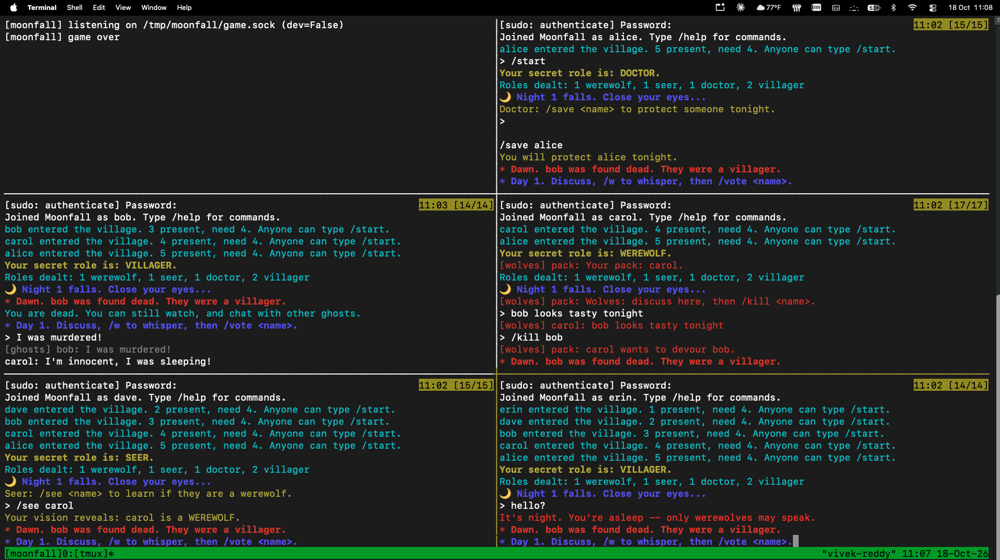

# Moonfall: a Werewolves-like game over UNIX sockets

Moonfall is a text-based social deduction game for Linux, built for Project #1.
Every player is a **separate process running as a separate Linux user**, and all
communication goes through a single library file, **`wolfnet.py`**. It uses
**UNIX domain stream sockets with asyncio (asynchronous I/O)**.




---

## The game

A moderator server secretly deals roles to 4 or more players:

| Role | Goal | Night action |
|---|---|---|
| **Werewolf** (1 per 4 players) | Eliminate villagers until wolves equal or outnumber them | `/kill <name>`, chosen with the pack in a private wolf chat |
| **Seer** | Find the wolves | `/see <name>`, once per night, to learn if that player is a werewolf |
| **Doctor** (5+ players) | Keep people alive | `/save <name>`, but not the same person two nights in a row |
| **Villager** | Find the wolves | None: talk, reason, and vote |

**Night:** only wolves can speak, in their pack channel. The seer and doctor act secretly.
The night ends as soon as everyone has acted, or when the timer runs out.

**☀ Day:** everyone discusses, can `/w` whisper privately, and votes with `/vote`.
- The vote tally is public and updates live.
- The player with the most votes is banished, and a tie banishes nobody.
- Everyone else sees *that* you whispered, but not *what* you said, so whispering is itself a clue.

**Dead players** keep watching and can talk to each other in a private ghosts channel.

**Win conditions:** the village wins when all wolves are dead. The wolves win when they equal or outnumber the rest.

---

## Quick start

Requirements: Ubuntu (tested on 26.04), Python 3.10 or newer, and tmux.
There are no pip packages to install and nothing to compile.

### Option A: real multi-user game (the intended way)
```bash
git clone https://github.com/<your-username>/moonfall.git
sudo cp -r moonfall /opt/moonfall       # home dirs are private on Ubuntu; other users can't read them
sudo chmod -R a+rX /opt/moonfall
cd /opt/moonfall
sudo ./setup_users.sh alice bob carol dave erin   # creates the users and the 'moonfall' group
newgrp moonfall                          # or log out and back in
sudo -v && ./play_tmux.sh                # server + 5 player panes, each a different Linux user
```
In tmux, switch panes with `Ctrl+b` followed by an arrow key. Once everyone has joined, type `/start` in any pane.

> **Run the game from `/opt/moonfall`, not from your home directory.** Ubuntu home
> directories are private, so the other player accounts can't read the game files there,
> and every player pane fails with `Permission denied`.

**Custom player names:** pass the **same names** to both scripts. If you don't give any names,
both scripts default to alice, bob, carol, dave and erin.
```bash
sudo ./setup_users.sh frank gina hank ivy
sudo -v && ./play_tmux.sh frank gina hank ivy
```
Before opening tmux, `play_tmux.sh` checks that every player account exists and can read the
game files. If one can't, it prints the exact fix.

### Option B: quick single-user test with bots
```bash
python3 moonfall_server.py --dev --night 20 --day 30 &
for n in bot1 bot2 bot3; do python3 moonfall_bot.py --nick $n & done
python3 moonfall_client.py --nick me     # then type /start
```
`--dev` lets one Linux user connect several times under nicknames. Never use it for real games.

### Restart a game
```bash
tmux kill-session -t moonfall && sudo -v && ./play_tmux.sh
```

---

## ⌨️ Commands

| Command | When | What it does |
|---|---|---|
| `<text>` | any time | Chat. During the day everyone hears you, at night only the wolf pack, and when dead only the ghosts |
| `/w <name> <text>` | day | Private whisper |
| `/vote <name>` | day | Vote to banish someone (you can change your vote) |
| `/kill <name>` | night, werewolf | Choose the victim |
| `/see <name>` | night, seer | Learn whether a player is a wolf |
| `/save <name>` | night, doctor | Protect a player |
| `/who` | any time | List the alive and dead players |
| `/start` | lobby | Start the game (needs 4 or more players) |
| `/help`, `/quit` | any time | Show help, or leave the game |

---

## The communications library: `wolfnet.py`

**Primitive:** UNIX domain **stream** sockets, driven by Python's **asyncio** event loop.
There is one task per connection, and nothing ever blocks the server.

**Wire format:** each message is a 4-byte big-endian length, followed by a UTF-8 JSON object
containing a `"type"` field. The maximum message size is 64 KB.

### Server API
```python
srv = Server(path, on_join, on_message, on_leave, dev=False)
await srv.start();  await srv.close()
srv.send(name, msg)                    # unicast
srv.multicast(group, msg, exclude=())  # e.g. "wolves", "ghosts"
srv.broadcast(msg, exclude=())         # everyone
srv.join_group(name, group);  srv.leave_group(name, group);  srv.members(group)
srv.kick(name, reason)
```

### Client API
```python
c = Client(path)
name = await c.connect(nick=None)      # returns the name the server assigned
await c.send("chat", text="hello")
msg = await c.recv()                   # a dict, or None when the server closes
await c.close()
```

### Where each communication pattern is used
| Pattern | Used for |
|---|---|
| **Unicast** | role assignment, seer results, doctor confirmation, whispers |
| **Multicast** | wolf pack chat at night, ghost chat |
| **Broadcast** | day chat, live votes, deaths, phase changes, game over |

### Security and robustness design
- **Unforgeable identity:** the server asks the kernel who is connecting, using
  `SO_PEERCRED`. Your player name is your Linux username, and the server stamps the
  `sender` field on every message it routes, so players can't impersonate each other.
- **Access control:** the socket file has mode `0660` and sits in the setgid
  directory `/tmp/moonfall`, owned by group `moonfall`.
- **Input limits:** oversized or malformed frames close the connection, and a
  client must send its hello within 10 seconds.
- **Flood protection:** each connection has a token-bucket rate limit
  (10 messages per second, burst 20), and repeat offenders are kicked.
- **Slow clients can't stall the game:** each connection has a bounded outgoing
  queue drained by its own writer task.
- **Server-authoritative rules:** the server validates every action.
- **Crash tolerance:** if a player disconnects mid-game, they "flee the village",
  their role is revealed, and the game continues.

---

## Files

| File | Purpose |
|---|---|
| **`wolfnet.py`** | ★ The communications library (single file) |
| `moonfall_server.py` | Moderator and game logic |
| `moonfall_client.py` | Interactive player terminal |
| `moonfall_bot.py` | Bot player that makes random legal moves |
| `setup_users.sh` | Creates the users, the `moonfall` group, and `/tmp/moonfall` |
| `play_tmux.sh` | Launches the server and one pane per player |

---

Here's a starting point for raw-socket testing:
```python
import socket, struct, json
s = socket.socket(socket.AF_UNIX); s.connect("/tmp/moonfall/game.sock")
send = lambda m: s.sendall(struct.pack("!I", len(d := json.dumps(m).encode())) + d)
send({"type": "hello"}); print(s.recv(4096))
# now try: send({"type": "chat", "text": "hi", "sender": "alice"}) ...
```

